# Architecture

This document describes how `vlc-ui` is put together: the Python classes, the QML files, and how data moves between them. The diagrams use [Mermaid](https://mermaid.js.org/), which GitHub renders directly.

> Keep this file in sync with the code. When a class, signal, property or slot is added, renamed or removed, update the diagrams below and add a line to [CURRENT_STATUS.md](CURRENT_STATUS.md).

## 1. Overview

The app is a single Qt Widgets window that stacks three areas vertically:

1. `TopBar` (a `QQuickWidget` running `TopBar.qml`, fixed height 40 px)
2. the canvas, a `QWidget` that holds the `RoundedFrame` where libVLC draws the video
3. `ControlBar` (a `QQuickWidget` running `ControlBar.qml`, fixed height 54 px)

The video lives in a native widget and is **not** a QML item. libVLC draws into that widget's X11 window id, which is why the controls sit *below* the video and not over it (see [Constraints](#6-constraints-and-design-decisions)).

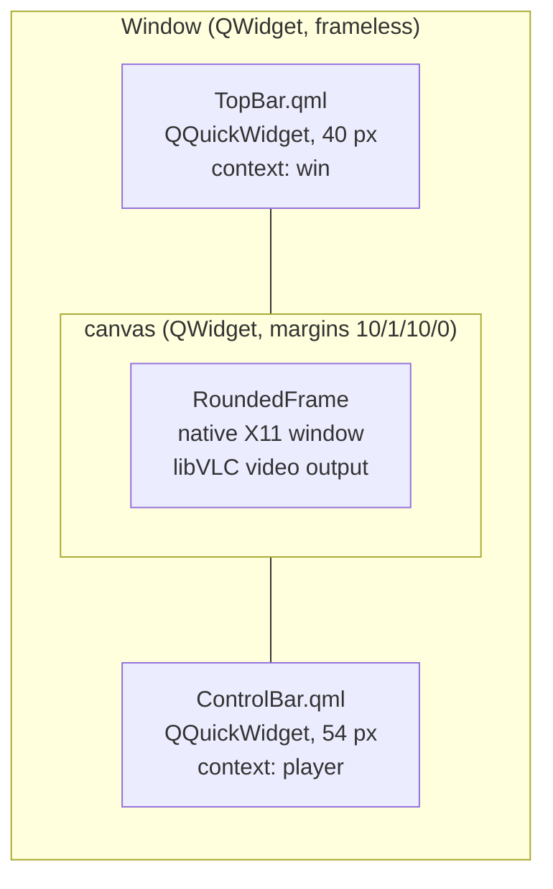

## 2. Python classes

The player is in `main.py`; `nowplaying.py` holds the now-playing sources and `mpris.py` the MPRIS service.

```mermaid
classDiagram
    direction LR

    class QObject
    class QWidget
    class QFrame
    class QSystemTrayIcon

    class PlayerController {
        +tick : Signal
        -mp : vlc.MediaPlayer
        -_stream : bool
        +position : float
        +timeMs : int
        +lengthMs : int
        +playing : bool
        +volume : int
        +live : bool
        +statusText : str
        +title : str
        -_now_text : str
        +set_stream(stream bool, media)
        +set_now_playing(text str)
        +togglePlay()
        +seek(pos float)
        +setVolume(v int)
    }

    class WindowController {
        +folderChanged : Signal
        -window : Window
        -_folder : str
        +folder : str
        +set_folder(name str)
        +startMove()
        +minimize()
        +toggleMaximize()
        +toggleFullscreen()
        +closeWindow()
        +openMedia()
        +openUrl()
    }

    class TrayIcon {
        +toggle_action
        +play_action
        +refresh_menu()
        +open_url()
        +on_activated(reason)
    }

    class NowPlayingSource {
        +updated : Signal
        +cover_loaded : Signal
        +interval : float
        +start()
        +stop()
    }

    class MprisService {
        +command : Signal
        +state : dict
        +bus_name : str
        +start()
        +stop()
        +update(state dict)
    }

    class NowPlayingPanel {
        +set_info(info dict)
        +set_cover(url str, data bytes)
        +cover_pixmap()
        +clear()
    }

    class RoundedFrame {
        +radius : int
        +resizeEvent(e)
    }

    class Window {
        +instance : vlc.Instance
        +mp : vlc.MediaPlayer
        +video : RoundedFrame
        +player_ctrl : PlayerController
        +win_ctrl : WindowController
        +top : QQuickWidget
        +bar : QQuickWidget
        +open_media()
        +play_path(path str)
        +open_url_dialog()
        +open_url(text str)
        +open_argument(arg str)
        -_play(media, stream bool)
        +tray : TrayIcon
        +panel : NowPlayingPanel
        +mpris : MprisService
        +on_tick()
        +mpris_state(title str)
        +sync_mpris(title str)
        -_on_mpris_command(name, argument)
        +open_uri(uri str)
        +sources : list
        -_song_info : dict
        -_now_source : NowPlayingSource
        -_start_now_playing(url str)
        -_stop_now_playing()
        -_on_now_playing(source, info dict)
        -_on_cover(source, result dict)
        +notify_song()
        +sync_tray_tooltip(title str)
        +closeEvent(e)
        +show_window()
        +toggle_visible()
        +quit_app()
    }

    QSystemTrayIcon <|-- TrayIcon
    QObject <|-- NowPlayingSource
    QObject <|-- MprisService
    QObject <|-- PlayerController
    QObject <|-- WindowController
    QFrame <|-- RoundedFrame
    QWidget <|-- Window

    Window "1" *-- "1" PlayerController : creates
    Window "1" *-- "1" WindowController : creates
    Window "1" *-- "1" RoundedFrame : video
    Window "1" *-- "1" TrayIcon : tray
    Window "1" *-- "1" MprisService : mpris
    Window ..> MprisService : update(state) on every tick
    MprisService ..> Window : command(name, argument)
    Window "1" o-- "0..1" NowPlayingSource : _now_source
    NowPlayingSource ..> Window : updated(info), cover_loaded(result)
    Window ..> PlayerController : set_now_playing(text)
    Window "1" *-- "1" NowPlayingPanel : panel (inside the video frame)
    Window ..> TrayIcon : notification, tooltip
    TrayIcon --> Window : show, hide, quit, open URL
    TrayIcon --> PlayerController : play / pause
    WindowController --> Window : window actions, open_media()
    PlayerController --> "vlc.MediaPlayer" : polls and commands
    Window --> "vlc.MediaPlayer" : set_media, set_xwindow, play
```

Module-level pieces that are not classes:

| Name | Role |
|------|------|
| `HERE` | `Path(__file__).parent`, base path for QML files and the QML import path |
| `STREAM_SCHEMES` | URL schemes accepted for network streams |
| `normalize_stream_url(text)` | Validates user text and returns a playable URL (adds `http://` when there is no scheme), or `None` |
| `load_sources(path)`, `find_source(url, sources)`, `read_song(config)` (`nowplaying.py`) | Read `nowplaying.json`, pick the entry whose `match` is in the stream URL, and fetch "Artist - Song" from the endpoint |
| `load_theme(path)` (`theme.py`) | Reads the tokens of `Theme.qml` (colors, font, sizes) so Python widgets and QML share one source; `THEME` in `main.py` holds the result |
| `cache_cover(data, key)`, `build_metadata(state)` (`mpris.py`) | Save the cover as a file for the shell to load (only the current one is kept) and build the MPRIS Metadata dictionary |
| `make_quick(ctx_name, ctrl, qml, height)` | Builds a `QQuickWidget`, adds `HERE` to the import path (so `qmldir` and `Theme` resolve), exposes `ctrl` to QML under `ctx_name`, loads the QML file and fixes the height |
| bottom of `main.py` | Creates `QApplication`, shows `Window`, runs the event loop |

### Responsibilities

| Class | Owns | Does not do |
|-------|------|-------------|
| `PlayerController` | Read access to playback state, including stream state (`live`, `statusText`, `title`); playback commands (play/pause, seek, volume); knows whether the media is a stream (`set_stream`) | Open files, touch widgets, know about windows |
| `WindowController` | Window actions (move, minimize, maximize, fullscreen, close), the folder name shown in the top bar, forwarding `openMedia()` | Talk to libVLC directly |
| `TrayIcon` | System tray icon and its menu; routes tray actions to `Window` and `PlayerController` | Decide whether the app quits (that is `Window.closeEvent` / `quit_app`) |
| `NowPlayingSource` | One background thread that polls a station's JSON endpoint, emits `updated(info)` when the song changes and `cover_loaded` with the image bytes (downloaded once per album) | Touch widgets or the player (the `Window` connects it) |
| `MprisService` | Publishes the player on the session bus (`org.mpris.MediaPlayer2.vlc_ui`) from its own thread; keeps the last state it was given and answers D-Bus reads from it; announces changes with PropertiesChanged | Touch the player or widgets: commands go out as the `command` signal |
| `NowPlayingPanel` | Draws cover, song, artist and album inside the video frame; hides the cover when there is no room | Download anything or decide when to show a notification |
| `RoundedFrame` | Rounded mask of the video area | Anything about playback |
| `Window` | Layout, libVLC `Instance` and `MediaPlayer`, hiding to the tray and quitting, file and URL dialogs, the `Ctrl+N` shortcut, command-line argument, attaching the video to the frame | Expose state to QML (that goes through the controllers) |

## 3. QML files

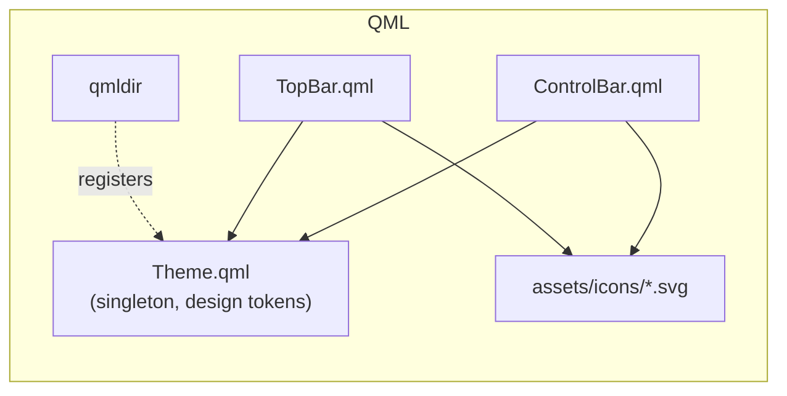

| File | Context property it uses | Notes |
|------|--------------------------|-------|
| `Theme.qml` | none | `pragma Singleton`. Colors, font, sizes. Registered in `qmldir`, so other files use `Theme.x` **without** `import Theme` |
| `TopBar.qml` | `win` (`WindowController`) | Window drag, double-click to maximize, folder button, window buttons |
| `ControlBar.qml` | `player` (`PlayerController`) | Prev / play-pause / next, seek bar, times, volume wedge, right-hand icons. For streams the seek bar shows the connection status or station / now playing, the total time becomes `LIVE`, and seeking is disabled |

## 4. Data flow

### 4.1 State: libVLC to the screen (polling)

`PlayerController` has a `QTimer` (200 ms) wired to a single `tick` signal. Every read-only property is declared with `notify=tick`, so each tick makes QML re-read all of them.

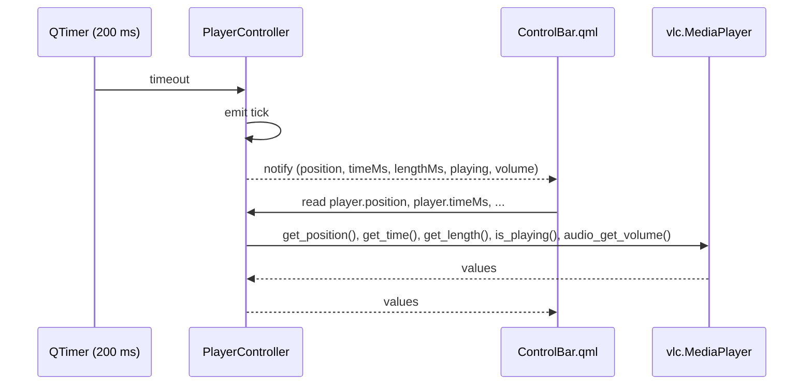

### 4.2 Commands: the screen to libVLC

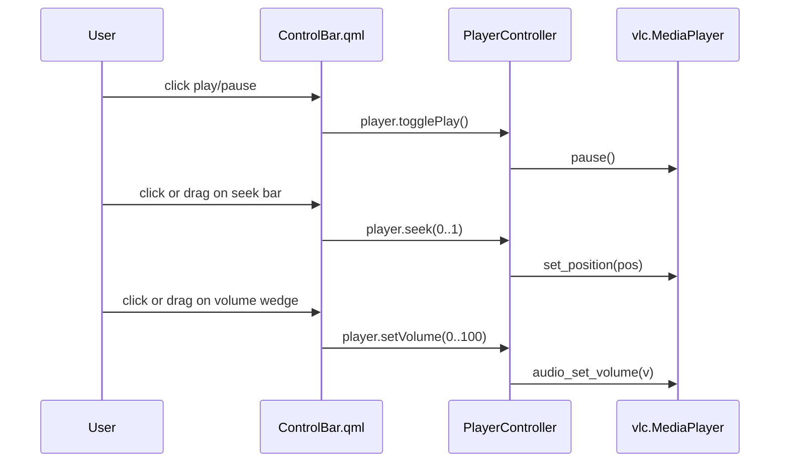

### 4.3 Opening a media file

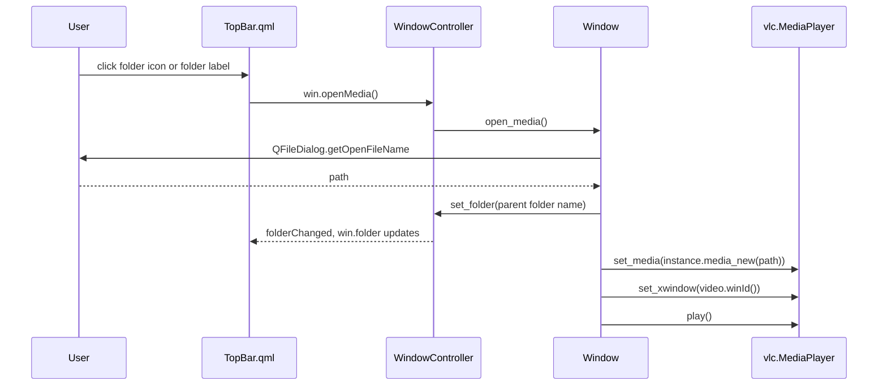

### 4.4 Opening a network stream

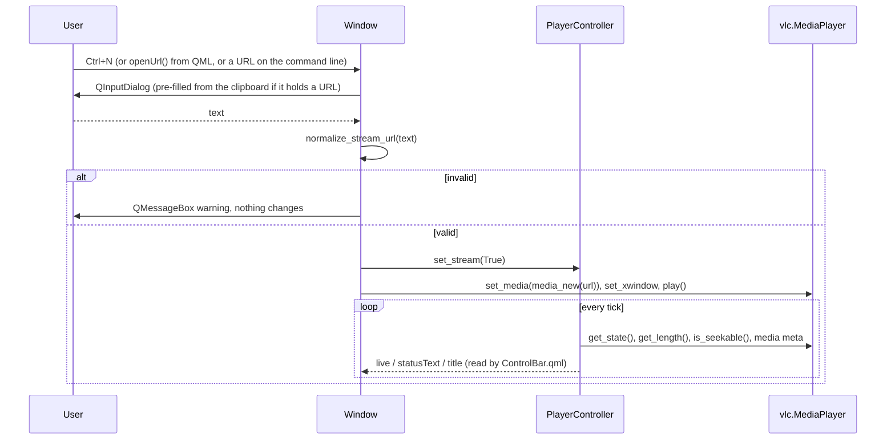

`live` is true when a stream is playing or paused and has no known length or cannot seek. `statusText` is non-empty while connecting, buffering, after an error or when the stream ended, and is always empty for local files.

#### Song from a station's API

Some stations only put filler in the ICY metadata. If `nowplaying.json` has an entry whose `match` is in the stream URL, `Window._play` starts a `NowPlayingSource` for it. The source asks the endpoint every `interval_seconds` (in a thread, so the interface never waits for the network) and emits `updated(info)` only when the song changes, followed by `cover_loaded` (the image is downloaded once per album and reused for the next songs). `Window` forwards the text to `PlayerController.set_now_playing`, and `title` returns it before the ICY metadata; the info goes to `NowPlayingPanel`, and when the cover arrives `Window.notify_song` shows a desktop notification (with the cover as its icon) if the window is hidden or minimized. The tray tooltip follows `PlayerController.title` on every tick. Opening another stream or a local file stops the source; an answer from a source that was already replaced is ignored. After three failed requests in a row the text is cleared, so an outdated song is not kept on screen.

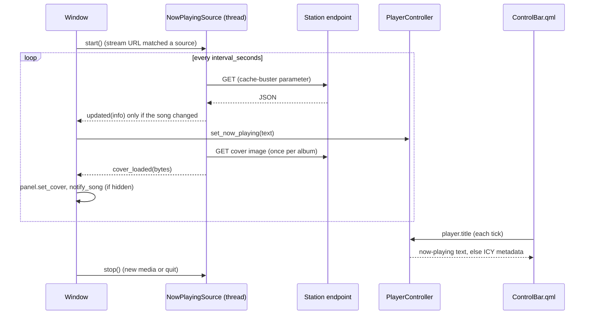

#### MPRIS (desktop integration)

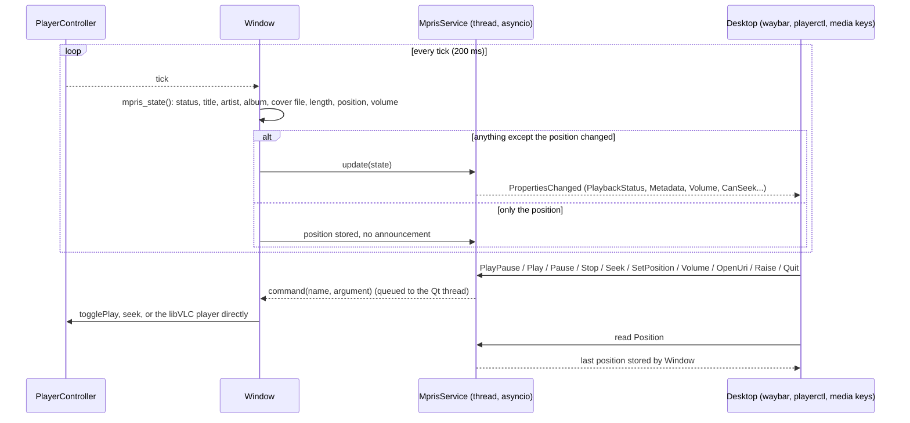

`Position` is read on demand by clients, so it is only stored, never announced. For a live stream it is 0 and `CanSeek` is false; for a station with a source, the title, artist, album and cover come from the now-playing source, otherwise from the stream metadata or the file name. The service claims the name `org.mpris.MediaPlayer2.vlc_ui`; if another player instance already owns it, it uses `...vlc_ui.instance<pid>`, as the MPRIS specification describes. Without `dbus-fast`, without a session bus, or outside Linux, the service does nothing and the player runs normally.

### 4.5 Closing, the system tray and quitting

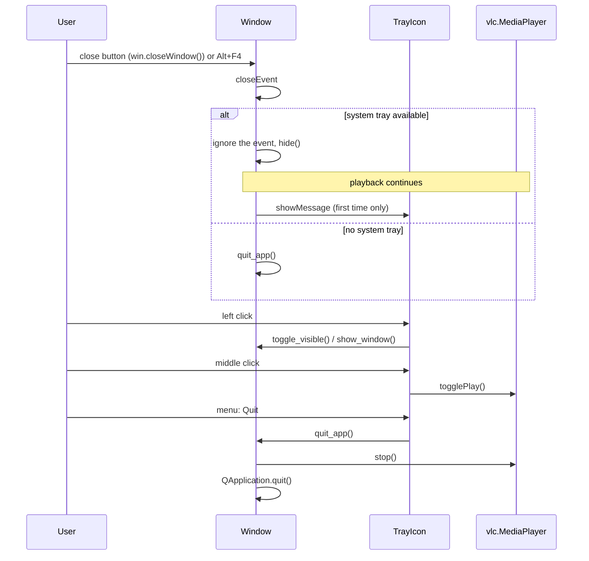

`main.py` calls `setQuitOnLastWindowClosed(False)`, otherwise closing a dialog while the main window is hidden would quit the app. Availability of the tray is checked at close time, so a window is never hidden when there is no icon to bring it back.

### 4.6 Window actions

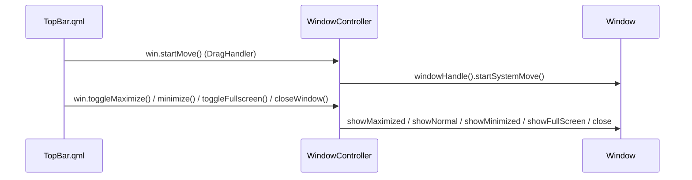

## 5. Window layout

| Area | Widget | Height | Margins |
|------|--------|--------|---------|
| Top bar | `QQuickWidget` (`TopBar.qml`) | 40 px (`Theme.topBarHeight`) | none |
| Canvas | `QWidget` with a `QVBoxLayout` | stretch (1) | 10 px left/right, 1 px top, 0 bottom |
| Video | `RoundedFrame` (radius 9, `Theme.canvasRadius`) | fills the canvas | none |
| Control bar | `QQuickWidget` (`ControlBar.qml`) | 54 px (`Theme.barHeight`) | none |

The window is frameless (`Qt.FramelessWindowHint`) and starts at 1100 x 640. Resizing from the edges is not implemented yet.

## 6. Constraints and design decisions

- **Video is a native widget.** libVLC draws into the X11 window id of `RoundedFrame` (`set_xwindow`). QML items cannot be drawn on top of a native window reliably, so controls are placed *below* the video, in separate `QQuickWidget`s.
- **X11 only for embedding.** On Wayland the app must run through XWayland (`QT_QPA_PLATFORM=xcb`), otherwise libVLC opens its own window.
- **Controllers are the only bridge.** QML talks to Python only through the context properties `win` and `player`. QML never reaches into libVLC, and controllers never touch QML items.
- **One signal for polled state.** `tick` drives every playback property. If a property needs its own timing, give it its own signal.
- **Design coordinates come from Figma.** `ControlBar.qml` positions the right-hand side from the window edge with `rx(d)`, based on the original 1920 px frame.
- **Theme is a singleton.** All colors, sizes and fonts come from `Theme.qml`.

## 7. Planned structure (not implemented)

Network streaming is already implemented inside the existing classes (see 4.4), so there is no separate stream controller.

This is where the roadmap items are expected to land. It is a plan, not current code.

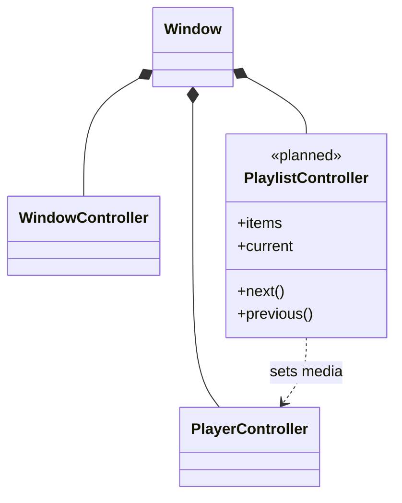

When `main.py` grows, the natural split is one module per controller (`player_controller.py`, `window_controller.py`, ...) with `main.py` reduced to application start-up.
