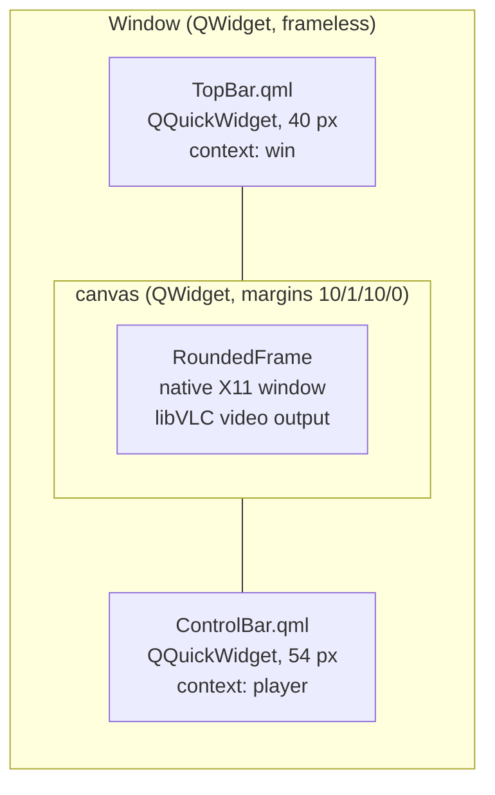
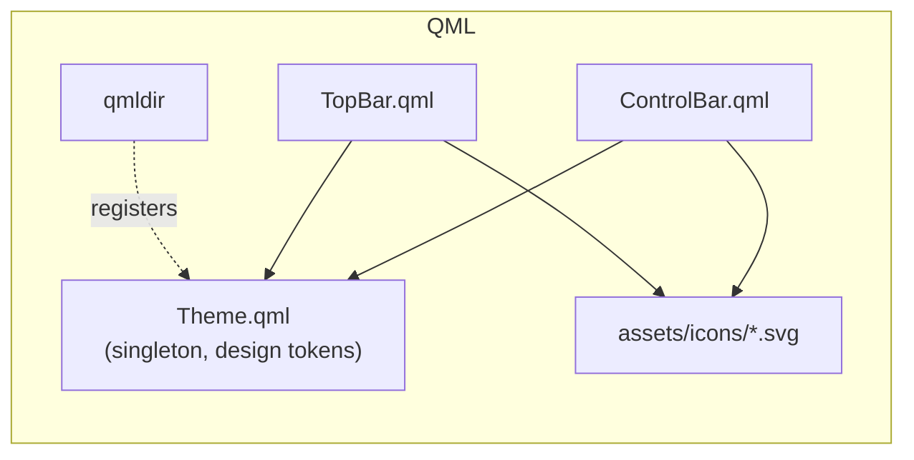
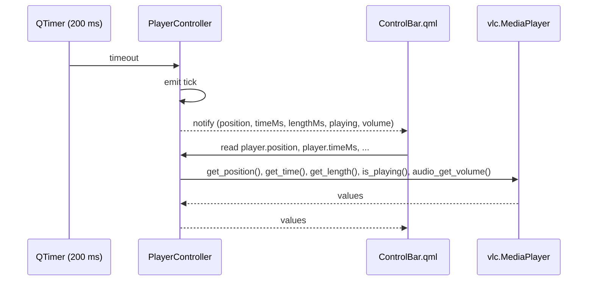
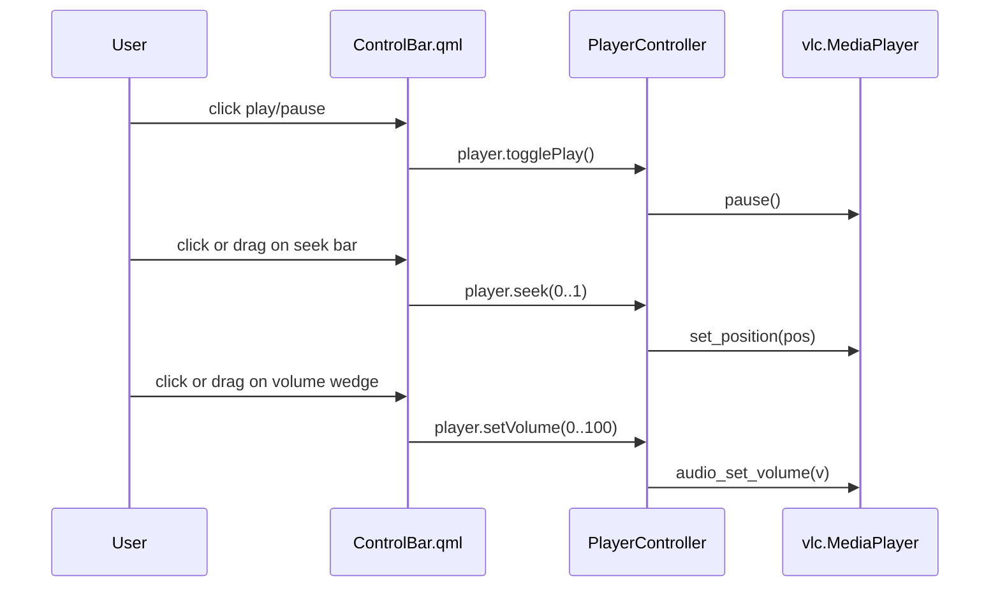
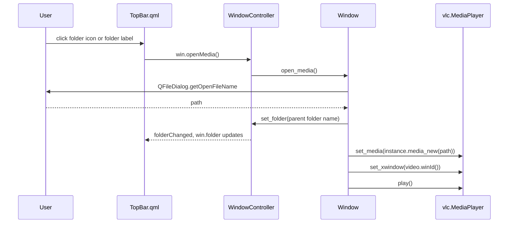
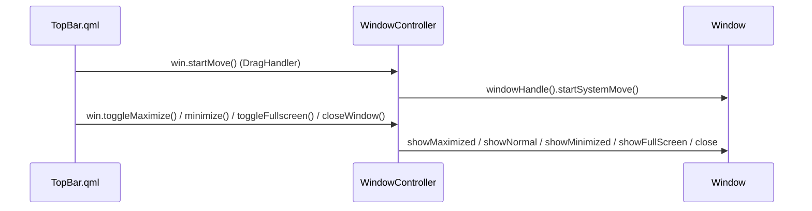
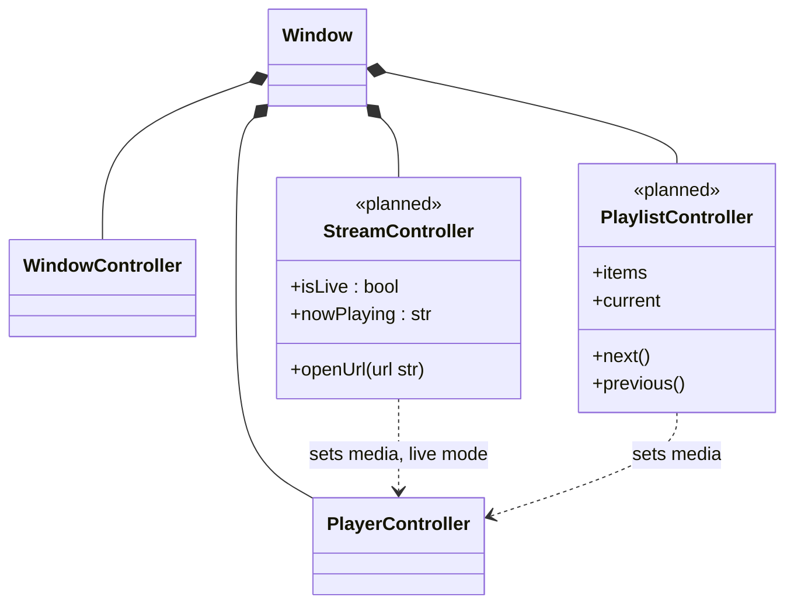

# Architecture

This document describes how `vlc-ui` is put together: the Python classes, the QML files, and how data moves between them. The diagrams use [Mermaid](https://mermaid.js.org/), which GitHub renders directly.

> Keep this file in sync with the code. When a class, signal, property or slot is added, renamed or removed, update the diagrams below and add a line to [CURRENT_STATUS.md](CURRENT_STATUS.md).

## 1. Overview

The app is a single Qt Widgets window that stacks three areas vertically:

1. `TopBar` (a `QQuickWidget` running `TopBar.qml`, fixed height 40 px)
2. the canvas, a `QWidget` that holds the `RoundedFrame` where libVLC draws the video
3. `ControlBar` (a `QQuickWidget` running `ControlBar.qml`, fixed height 54 px)

The video lives in a native widget and is **not** a QML item. libVLC draws into that widget's X11 window id, which is why the controls sit *below* the video and not over it (see [Constraints](#6-constraints-and-design-decisions)).



## 2. Python classes

All Python code is currently in `main.py`.

```mermaid
classDiagram
    direction LR

    class QObject
    class QWidget
    class QFrame

    class PlayerController {
        +tick : Signal
        -mp : vlc.MediaPlayer
        +position : float
        +timeMs : int
        +lengthMs : int
        +playing : bool
        +volume : int
        +togglePlay()
        +seek(pos float)
        +setVolume(v int)
    }

    class WindowController {
        +folderChanged : Signal
        -window : Window
        -_folder : str
        +folder : str
        +set_folder(name str)
        +startMove()
        +minimize()
        +toggleMaximize()
        +toggleFullscreen()
        +closeWindow()
        +openMedia()
    }

    class RoundedFrame {
        +radius : int
        +resizeEvent(e)
    }

    class Window {
        +instance : vlc.Instance
        +mp : vlc.MediaPlayer
        +video : RoundedFrame
        +player_ctrl : PlayerController
        +win_ctrl : WindowController
        +top : QQuickWidget
        +bar : QQuickWidget
        +open_media()
    }

    QObject <|-- PlayerController
    QObject <|-- WindowController
    QFrame <|-- RoundedFrame
    QWidget <|-- Window

    Window "1" *-- "1" PlayerController : creates
    Window "1" *-- "1" WindowController : creates
    Window "1" *-- "1" RoundedFrame : video
    WindowController --> Window : window actions, open_media()
    PlayerController --> "vlc.MediaPlayer" : polls and commands
    Window --> "vlc.MediaPlayer" : set_media, set_xwindow, play
```

Module-level pieces that are not classes:

| Name | Role |
|------|------|
| `HERE` | `Path(__file__).parent`, base path for QML files and the QML import path |
| `make_quick(ctx_name, ctrl, qml, height)` | Builds a `QQuickWidget`, adds `HERE` to the import path (so `qmldir` and `Theme` resolve), exposes `ctrl` to QML under `ctx_name`, loads the QML file and fixes the height |
| bottom of `main.py` | Creates `QApplication`, shows `Window`, runs the event loop |

### Responsibilities

| Class | Owns | Does not do |
|-------|------|-------------|
| `PlayerController` | Read access to playback state; playback commands (play/pause, seek, volume) | Open files, touch widgets, know about windows |
| `WindowController` | Window actions (move, minimize, maximize, fullscreen, close), the folder name shown in the top bar, forwarding `openMedia()` | Talk to libVLC directly |
| `RoundedFrame` | Rounded mask of the video area | Anything about playback |
| `Window` | Layout, libVLC `Instance` and `MediaPlayer`, file dialog, attaching the video to the frame | Expose state to QML (that goes through the controllers) |

## 3. QML files



| File | Context property it uses | Notes |
|------|--------------------------|-------|
| `Theme.qml` | none | `pragma Singleton`. Colors, font, sizes. Registered in `qmldir`, so other files use `Theme.x` **without** `import Theme` |
| `TopBar.qml` | `win` (`WindowController`) | Window drag, double-click to maximize, folder button, window buttons |
| `ControlBar.qml` | `player` (`PlayerController`) | Prev / play-pause / next, seek bar, times, volume wedge, right-hand icons |

## 4. Data flow

### 4.1 State: libVLC to the screen (polling)

`PlayerController` has a `QTimer` (200 ms) wired to a single `tick` signal. Every read-only property is declared with `notify=tick`, so each tick makes QML re-read all of them.



### 4.2 Commands: the screen to libVLC



### 4.3 Opening a media file



### 4.4 Window actions



## 5. Window layout

| Area | Widget | Height | Margins |
|------|--------|--------|---------|
| Top bar | `QQuickWidget` (`TopBar.qml`) | 40 px (`Theme.topBarHeight`) | none |
| Canvas | `QWidget` with a `QVBoxLayout` | stretch (1) | 10 px left/right, 1 px top, 0 bottom |
| Video | `RoundedFrame` (radius 9, `Theme.canvasRadius`) | fills the canvas | none |
| Control bar | `QQuickWidget` (`ControlBar.qml`) | 54 px (`Theme.barHeight`) | none |

The window is frameless (`Qt.FramelessWindowHint`) and starts at 1100 x 640. Resizing from the edges is not implemented yet.

## 6. Constraints and design decisions

- **Video is a native widget.** libVLC draws into the X11 window id of `RoundedFrame` (`set_xwindow`). QML items cannot be drawn on top of a native window reliably, so controls are placed *below* the video, in separate `QQuickWidget`s.
- **X11 only for embedding.** On Wayland the app must run through XWayland (`QT_QPA_PLATFORM=xcb`), otherwise libVLC opens its own window.
- **Controllers are the only bridge.** QML talks to Python only through the context properties `win` and `player`. QML never reaches into libVLC, and controllers never touch QML items.
- **One signal for polled state.** `tick` drives every playback property. If a property needs its own timing, give it its own signal.
- **Design coordinates come from Figma.** `ControlBar.qml` positions the right-hand side from the window edge with `rx(d)`, based on the original 1920 px frame.
- **Theme is a singleton.** All colors, sizes and fonts come from `Theme.qml`.

## 7. Planned structure (not implemented)

This is where the roadmap items are expected to land. It is a plan, not current code.



When `main.py` grows, the natural split is one module per controller (`player_controller.py`, `window_controller.py`, ...) with `main.py` reduced to application start-up.
