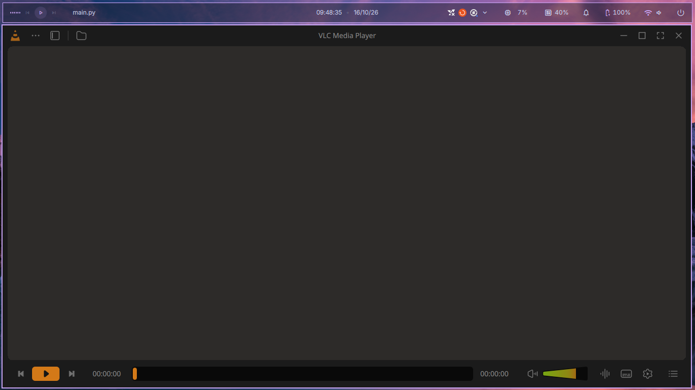
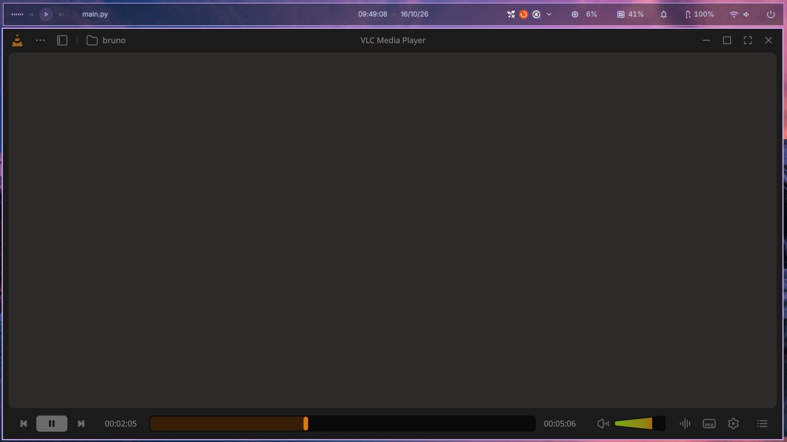
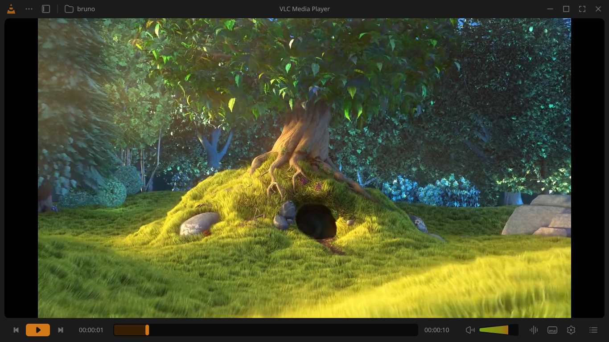

# vlc-ui

A from-scratch redesign of the VLC media player interface, built with **Python**, **PySide6 (Qt Quick / QML)** and **libVLC**.

The playback engine is VLC's own [libVLC](https://www.videolan.org/vlc/libvlc.html), accessed through the [python-vlc](https://github.com/oaubert/python-vlc) bindings. Everything you see on screen is a new interface, written in QML and based on a community design made in Figma.

> **Status:** work in progress. The top bar, the control bar and basic playback work. Playlist, sidebar and menus are not implemented yet (see [Roadmap](#roadmap)).

## Demo

https://github.com/user-attachments/assets/06e5daa2-e293-4d07-a748-5018046563c3

## Screenshots







The media shown in the demo and screenshots is listed in [Demo media credits](#demo-media-credits).

## Design credit

The visual design is the work of **[@juxtopposed](https://www.youtube.com/@juxtopposed)**, who redesigned the whole VLC interface in Figma and published the project as open source on the Figma Community:

- Figma file: [VLC Redesign (Community)](https://www.figma.com/community/file/1691465999134370980)
- Video that inspired this project: [watch on YouTube](https://www.youtube.com/watch?v=ERFeOgqk324)
- Channel: [youtube.com/@juxtopposed](https://www.youtube.com/@juxtopposed)

All credit for the layout, colors, icons and visual identity goes to her. This repository only implements her design as a working player. Please check the license of the Figma file before redistributing the design assets.

## How this project was made

This project was created with the help of **Claude** (by Anthropic) and was **entirely reviewed by me**, the author. The code was written, tested and adjusted step by step against the Figma design, and I read and ran every part of it before publishing.

## Features

- Frameless window with a custom title bar (drag to move, double-click to maximize, minimize, maximize, fullscreen and close buttons)
- Open media from the folder button in the top bar
- Play network streams, for example an online radio (`Ctrl+N`, or a URL on the command line). Streams show a **LIVE** state with the station and now-playing text instead of the seek bar
- Show the song that is playing on a radio: from the stream's own metadata, or from the station's web API for stations that do not publish it in the stream (configured in `nowplaying.json`; Antena 1 is included). When the station provides it, the empty video area shows the album cover, song, artist and album, and a desktop notification announces each new song while the window is hidden in the tray
- Tell the desktop what is playing through **MPRIS** (Linux): status bars such as waybar, `playerctl`, media keys and lock screens show the song, artist, album and cover, and can play, pause and seek
- Keep playing in the background from the **system tray**: closing the window hides it, and the tray icon brings it back
- Play / pause, seek bar with played-time fill and handle, current and total time
- Volume control with the gradient wedge from the design
- Rounded video canvas, colors and spacing taken from the Figma frame
- Layout based on the original 1920px design: the right side of the control bar is anchored to the window edge, so it adapts to smaller windows

## Platform notes

This project was developed on **Linux** and tested on **Ubuntu with Wayland**.

> **Important (Wayland):** libVLC embeds the video into a native window using an X11 window ID, so the app must run through XWayland. On Wayland I had to start it with `QT_QPA_PLATFORM=xcb`. Without it, the video opens in a **separate window** instead of inside the player.

For example, in fish:

```fish
set -x QT_QPA_PLATFORM xcb
python main.py
```

Windows and macOS instructions are at the end of this document and are **untested**.

## Requirements

- Python 3.10 or newer
- [VLC](https://www.videolan.org/vlc/) installed on the system (the Python package only calls the installed libVLC library)
- Python packages: `PySide6` and `python-vlc`; on Linux also `dbus-fast` (optional, only for MPRIS)
- [Inter](https://rsms.me/inter/) font (optional, used by the design; Qt falls back to another font if it is missing)

### Ubuntu / Debian

```bash
sudo apt install vlc libvlc-dev python3-venv fonts-inter libxcb-cursor0
```

`libxcb-cursor0` is needed by recent Qt versions to load the `xcb` platform plugin.

## Installation and running (Linux)

Clone the repository and create a virtual environment.

**bash / zsh:**

```bash
git clone https://github.com/BrunoGiubilei/vlc-ui.git
cd vlc-ui
python3 -m venv .venv
source .venv/bin/activate
pip install PySide6 python-vlc dbus-fast
```

**fish:**

```fish
git clone https://github.com/BrunoGiubilei/vlc-ui.git
cd vlc-ui
python3 -m venv .venv
source .venv/bin/activate.fish
pip install PySide6 python-vlc dbus-fast
```

Run the player:

```bash
# X11 session
python main.py

# Wayland session (required, see "Platform notes")
QT_QPA_PLATFORM=xcb python main.py
```

In fish, use `env QT_QPA_PLATFORM=xcb python main.py` or `set -x QT_QPA_PLATFORM xcb` before running.

To leave the virtual environment, run `deactivate`.

### Install as an application (Linux)

`main.py` selects the `xcb` platform by itself on Linux, so no environment variable is needed. To start the player without activating the virtual environment, and to get an entry in the application menu:

```
./install-desktop.sh
vlc-ui
```

The script creates a `~/.local/bin/vlc-ui` symlink and a `~/.local/share/applications/vlc-ui.desktop` entry. Run it again if you move the project folder, and use `./install-desktop.sh --uninstall` to remove both.

## Usage

- Click the **folder icon** (or the folder label) in the top bar to open a media file.
- Press **Ctrl+N** to open a network stream: paste a URL such as `https://example.com/radio.mp3`. A URL without a scheme is treated as `http://`. Supported schemes: http, https, rtsp, rtmp, mms, mmsh, udp, rtp, ftp.
- You can also pass a URL or a file on the command line: `python main.py https://example.com/radio.mp3`.
- **Closing the window** (the close button or Alt+F4) hides it in the system tray and playback continues. Left click on the tray icon shows or hides the window, middle click plays or pauses, and the right click menu has Show/Hide, Play/Pause, Open network stream and **Quit**. Use Quit to exit the player.
- If the desktop has no system tray, closing the window quits the player as usual. GNOME shows no tray icons by default; it needs an extension such as AppIndicator and KStatusNotifierItem Support.
- Drag the top bar to move the window; double-click it to maximize.
- Click the seek bar to jump to a position, and click or drag on the volume wedge to change the volume.

### Song titles for radios

Many stations send the song title inside the audio stream (ICY metadata) and the player shows it automatically. Some stations only send filler such as the station name; for those, the song can come from the JSON endpoint that the station's own website uses. These endpoints are described in `nowplaying.json`:

```json
{
  "sources": [
    {
      "name": "Antena 1",
      "match": "antenaone.crossradio.com.br",
      "url": "https://www.antena1.com.br/api/v1/aovivo/getCurrentSongInfo/antena_1?FYC=5979975",
      "cache_bust_param": "FYC",
      "interval_seconds": 10,
      "ok": { "path": "status", "equals": "success" },
      "fields": { "artist": "data.artist", "song": "data.song" }
    }
  ]
}
```

- `match`: text that must appear in the stream URL for this entry to be used.
- `url`: the endpoint. `cache_bust_param` (optional) is a query parameter that gets a fresh random value on each request; if the station rejects that, the URL is requested exactly as written.
- `interval_seconds`: how often to ask (minimum 5).
- `ok` (optional): a field that must have this value for the answer to count.
- `fields`: dotted paths to the `artist` and the `song` in the JSON (`items.0.title` also works for lists), and optionally the `album`, the `year` and the `cover` (an image URL). With a cover, the player downloads it once per album and shows it with the song; without these fields only the title is shown.

The tray icon tooltip always shows what is playing. The notification for each new song appears only while the window is hidden or minimized, and only for stations with a source in `nowplaying.json`.

To add a station, open its web player in the browser, open the developer tools (F12), go to Network, filter by Fetch/XHR and look for the request that returns the current song. Run `python tools/icy_probe.py STREAM_URL` first to check whether the stream already carries the title. These endpoints are not public APIs, so they can change without notice.

### Desktop integration (MPRIS)

On Linux the player publishes itself on the session bus as `org.mpris.MediaPlayer2.vlc_ui` (it needs the optional `dbus-fast` package). Anything that understands MPRIS can then show and control it:

- the title, artist, album and cover of what is playing (for a station with a source in `nowplaying.json`, the song; for a local file, the file name and length);
- play, pause, stop, seek and volume, and opening an address with `playerctl open`;
- the player is listed under the name "VLC UI", linked to `vlc-ui.desktop` for its icon.

Niri has no media widget of its own: the bar or shell you run on top of it shows the song, as long as it reads MPRIS (waybar, quickshell-based shells and most others do). Check that the player is visible with:

```
playerctl -l                  # should list vlc_ui
playerctl -p vlc_ui metadata  # title, artist, album, cover
playerctl -p vlc_ui play-pause
```

For waybar, the `mpris` module shows it, for example `"mpris": { "format": "{player_icon} {dynamic}" }`. For the media keys in Niri, bind them to `playerctl` in `config.kdl`:

```
binds {
    XF86AudioPlay allow-when-locked=true { spawn "playerctl" "play-pause"; }
    XF86AudioNext allow-when-locked=true { spawn "playerctl" "next"; }
    XF86AudioPrev allow-when-locked=true { spawn "playerctl" "previous"; }
}
```

(`next` and `previous` do nothing yet: there is no playlist.) If several players are running, `playerctl` controls the one that was most recently active unless you pass `-p vlc_ui`. The cover is saved as a file in `~/.cache/vlc-ui/` (only the current one is kept) so the shell can load it.

## Project structure

```
vlc-ui/
├── main.py          # Qt window, libVLC player and Python <-> QML controllers
├── nowplaying.py    # Song titles and covers from a station's own web API
├── nowplaying_panel.py  # Cover, song and album shown in the empty video area
├── mpris.py         # MPRIS (D-Bus) service: status bars, playerctl and media keys
├── theme.py         # Reads the design tokens from Theme.qml for the Python widgets
├── nowplaying.json  # Stations that need it (stream match, endpoint, JSON fields)
├── vlc-ui           # Launcher script (uses .venv, works from any folder)
├── install-desktop.sh  # Installs the launcher and the application menu entry
├── tools/
│   └── icy_probe.py # Shows what a radio stream publishes as "now playing"
├── Theme.qml        # Design tokens (colors, sizes, font), registered as a singleton
├── qmldir           # Exposes Theme.qml to the other QML files
├── TopBar.qml       # Custom title bar
├── ControlBar.qml   # Playback controls
├── assets/
│   └── icons/       # SVG icons exported from the Figma design
└── docs/            # Screenshots used in this README
```

### How it works

- The video is rendered by libVLC into a native `QFrame` (`set_xwindow`).
- The top bar and the control bar are `QQuickWidget`s that load QML files.
- `PlayerController` exposes the playback state (position, time, length, volume, playing, and for streams `live`, `statusText` and `title`) to QML and receives actions such as play/pause, seek and volume.
- `NowPlayingSource` (in `nowplaying.py`) polls a station's web API in a background thread and hands the song to `PlayerController`, which shows it instead of the stream metadata, and the cover to `NowPlayingPanel`, which draws it inside the video frame (a plain Qt widget, visible only while no video is playing). Python widgets take their colors, font and sizes from `Theme.qml` through `theme.py`.
- `MprisService` (in `mpris.py`) runs the MPRIS D-Bus service in a background thread. `Window` pushes the current state to it on every tick, and the commands it receives (play, pause, seek, volume, open) come back to the Qt thread as a signal.
- `WindowController` handles window actions (move, minimize, maximize, fullscreen, close, open media, open stream URL). `TrayIcon` is the system tray icon and its menu; closing the window hides it there instead of quitting.
- The controls sit *below* the video instead of over it, which avoids the compositing conflict between libVLC's native video window and QML overlays.

## Roadmap

Next up:

1. A visible entry for "Open network stream" in the interface (today it is only the `Ctrl+N` shortcut) and support for playlist URLs (`.m3u` / `.pls`), which many radios use.
2. A compiled executable for the standalone program (the launcher and the `.desktop` entry already work). Optional, see [Install as an application](#install-as-an-application-linux).

Then:

- Single instance: running `vlc-ui` again should show the window that is already in the tray instead of opening a second player
- Previous / next buttons and a playlist
- Left sidebar and the "more options" menu
- Equalizer, subtitles and media settings menus
- Window resizing from the edges (frameless window)
- Overlay controls on top of the video (libVLC video callbacks or libmpv)
- Windows and macOS support

## Troubleshooting

| Problem | Fix |
| --- | --- |
| The video opens in a separate window | Run with `QT_QPA_PLATFORM=xcb` (Wayland) |
| `Could not load the Qt platform plugin "xcb"` | `sudo apt install libxcb-cursor0` |
| `module "Theme" is not installed` | Keep `qmldir` next to the QML files and do not `import Theme` in them |
| An icon does not show up | Check that its file name matches the path in the QML and that it exists in `assets/icons/` |
| A radio shows no song title | Not every station publishes it. Run `python tools/icy_probe.py URL --vlc` to see what the station sends (ICY metadata and status pages) and what libVLC reads from it |
| The player does not show in my bar, or `playerctl -l` does not list `vlc_ui` | Install `dbus-fast` in the project's environment (`.venv/bin/pip install dbus-fast`), make sure the session bus is available (`echo $DBUS_SESSION_BUS_ADDRESS`), and start the player from a terminal to read the message it prints. Check that your bar has an MPRIS module |
| There is no tray icon and closing the window quits the player | The desktop has no system tray. On GNOME, install the AppIndicator and KStatusNotifierItem Support extension |
| `python-vlc` cannot find libVLC | Make sure VLC is installed with the same architecture as Python (64-bit with 64-bit) |

## Credits and licenses

- **Design:** [@juxtopposed](https://www.youtube.com/@juxtopposed), [VLC Redesign (Community)](https://www.figma.com/community/file/1691465999134370980). Check the license of the Figma file for the design and icon assets.
- **Playback engine:** [libVLC](https://www.videolan.org/vlc/libvlc.html), part of the [VLC media player](https://www.videolan.org/vlc/) by [VideoLAN](https://www.videolan.org/). libVLC is licensed under the LGPL 2.1 or later.
- **Python bindings:** [python-vlc](https://github.com/oaubert/python-vlc) by Olivier Aubert, licensed under the LGPL 2.1 or later.
- **UI toolkit:** [Qt for Python (PySide6)](https://doc.qt.io/qtforpython-6/), licensed under the LGPL / GPL / commercial licenses.
- **Font:** [Inter](https://rsms.me/inter/), licensed under the SIL Open Font License.
- **AI assistance:** built with the help of [Claude](https://www.anthropic.com/claude) by Anthropic and fully reviewed by the author.

### Demo media credits

The demo video and screenshots use the following test media. None of it is part of this repository.

- *Big Buck Bunny*, (c) Blender Foundation | [peach.blender.org](https://peach.blender.org/), licensed under [CC BY 3.0](https://creativecommons.org/licenses/by/3.0/).
- *Sintel*, (c) Blender Foundation | [durian.blender.org](https://durian.blender.org/), licensed under [CC BY 3.0](https://creativecommons.org/licenses/by/3.0/).
- *Jellyfish* test clip, from the [Jellyfish test videos](https://jell.yfish.us/) collection.
- Music by Kevin MacLeod ([incompetech.com](https://incompetech.com/)), licensed under [Creative Commons: By Attribution 4.0](https://creativecommons.org/licenses/by/4.0/).

This is an independent, community project and is **not affiliated with or endorsed by VideoLAN**. "VLC" and the VLC cone are trademarks of VideoLAN.

## License

The code in this repository is released under the [MIT License](LICENSE).

The design and its icons are the work of [@juxtopposed](https://www.youtube.com/@juxtopposed) and are **not** covered by the MIT License. Check the license of the [Figma file](https://www.figma.com/community/file/1691465999134370980) before redistributing them.

---

## Windows and macOS (untested)

I developed and tested this project only on Linux, so the steps below are a starting point rather than a verified guide.

The current `main.py` embeds the video with `set_xwindow`, which only exists on X11. On Windows and macOS, replace that call in `open_media` with a platform-specific one:

```python
import sys

wid = int(self.video.winId())
if sys.platform.startswith("linux"):
    self.mp.set_xwindow(wid)
elif sys.platform == "win32":
    self.mp.set_hwnd(wid)
elif sys.platform == "darwin":
    self.mp.set_nsobject(wid)
```

### Windows

1. Install [Python 3.10+](https://www.python.org/downloads/) and [VLC](https://www.videolan.org/vlc/) (64-bit with 64-bit).
2. In PowerShell:

```powershell
git clone https://github.com/BrunoGiubilei/vlc-ui.git
cd vlc-ui
py -m venv .venv
.venv\Scripts\Activate.ps1
pip install PySide6 python-vlc
python main.py
```

If PowerShell blocks the activation script, run `Set-ExecutionPolicy -Scope CurrentUser RemoteSigned` once. No `QT_QPA_PLATFORM` variable is needed.

### macOS

1. Install Python 3.10+ and [VLC](https://www.videolan.org/vlc/) (the app in `/Applications`).
2. In Terminal:

```bash
git clone https://github.com/BrunoGiubilei/vlc-ui.git
cd vlc-ui
python3 -m venv .venv
source .venv/bin/activate
pip install PySide6 python-vlc
python main.py
```

If `python-vlc` cannot find libVLC, point it to the VLC app's library:

```bash
export PYTHON_VLC_LIB_PATH="/Applications/VLC.app/Contents/MacOS/lib/libvlc.dylib"
```
